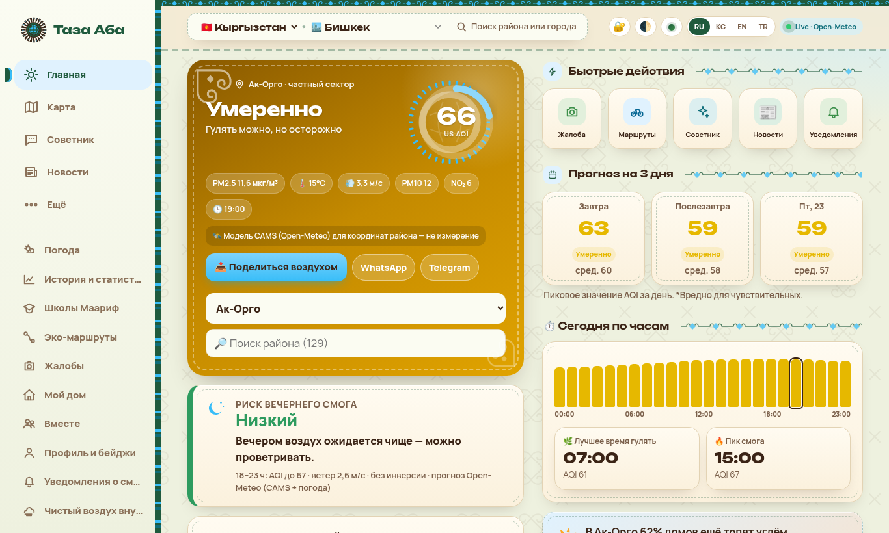
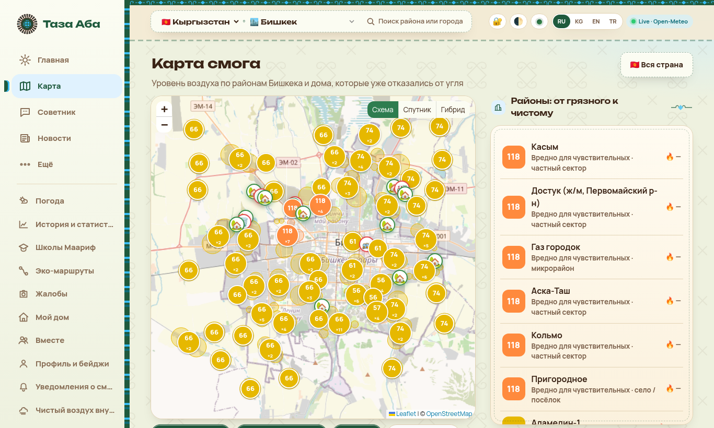

# Таза Аба — чистый воздух

**Таза Аба** («чистый воздух» по-кыргызски) — веб-приложение против зимнего смога в Кыргызстане и в Турции: качество воздуха по районам, прогноз, советы и инструменты для жителей и мэрии. Охват — **58 городов**.

🌐 **Сайт:** https://taza-aba.surge.sh/ (основной) · зеркало на GitHub Pages: https://zusenbaev7-cmd.github.io/taza-aba/



## Возможности

- **Карта AQI** по районам и населённым пунктам, слои «Схема / Спутник / Гибрид», рейтинг районов от грязного к чистому.
- **Прогноз** на 3 дня и по часам, риск вечернего смога, лучшее время для прогулки.
- **Трафик и смог** — карта загруженности улиц и вклада транспорта. Это **оценка** (модель по классу дороги, часу и дню недели), а не живые пробки; живые данные TomTom включаются только для Турции и только при собственном ключе.
- **Советник** — что делать при текущем уровне загрязнения: проветривание, маски, прогулки, дети и пожилые.
- **Жалобы** — оформление обращения о дыме или сжигании мусора.
- **Панель для мэрии** — сводка по городу, памятка для служб и **открытый архив** суточных значений (`archive/*.csv`, пополняется каждую ночь GitHub Actions).
- **Школы Маариф** — карта школ и качество воздуха рядом с ними.
- **Аккаунты со сквозным шифрованием**: профиль хранится зашифрованным (AES-GCM, ключ из пароля через PBKDF2), есть код восстановления и «Запомнить меня на этом устройстве».
- **4 языка**: кыргызский, русский, английский, турецкий. Светлая и тёмная темы.
- **PWA** (работает офлайн, устанавливается на телефон) и **приложение для Windows** (портативный .exe на Neutralino).



## Источники данных — честно

| Источник | Что даёт | Оговорка |
|---|---|---|
| [Open-Meteo](https://open-meteo.com/) / [CAMS](https://atmosphere.copernicus.eu/) | PM2.5, PM10, NO₂, погода, прогноз | Это **модель** (расчёт на сетке ~10–40 км), а не измерение. В приложении так и подписано. |
| [Sensor.Community](https://sensor.community/) | Народные датчики PM | Реальные измерения, но любительские датчики; показываем медиану по городу. Не во всех районах они есть. |
| [OpenStreetMap](https://www.openstreetmap.org/) (Geofabrik, Overpass, Nominatim) | Улицы, школы, районы, поиск | Данные © участники OpenStreetMap, ODbL. |
| WAQI, AirNow | Станции и посольские мониторы, где доступны | AirNow для Бишкека с марта 2025 не передаёт данные. |

Оценки (трафик, вклад отопления и т.п.) везде помечены словом «оценка». Мы не выдумываем станции, цифры и места.

## Технологии

- Чистый HTML/CSS/JavaScript **без сборки**, хеш-маршрутизация, Service Worker.
- [Leaflet](https://leafletjs.com/) (canvas-рендер) для карт, тайлы OSM.
- WebCrypto (PBKDF2-SHA256 + AES-GCM), IndexedDB.
- Необязательный серверный режим аккаунтов на Supabase (`backend/`: схема с RLS и приватным бакетом) — пока не подключён, приложение работает в локальном режиме.
- GitHub Actions: ночной архив (`.github/workflows/daily-archive.yml`) и бот смог-оповещений.
- Хостинг: Surge и GitHub Pages; Windows-сборка — Neutralino.

## Как запустить локально

```bash
git clone https://github.com/zusenbaev7-cmd/taza-aba.git
cd taza-aba
python3 -m http.server 8765
# открыть http://localhost:8765/
```

Нужен только статический сервер (Service Worker не работает с `file://`). Ключи не обязательны; необязательные настройки — в `config.js`.

## Приватность

- Без рекламы и рекламных трекеров. Есть только анонимный счётчик посещений (Abacus: число устройств и открытий, без персональных данных; опционально GoatCounter, если задан в `config.js`). Выбранный район, настройки и избранное хранятся в браузере (localStorage / IndexedDB).
- Профиль аккаунта шифруется на устройстве; пароль и ключ никуда не отправляются. Если сервер будет подключён, на нём будет лежать только шифротекст.
- Геолокация используется только по нажатию кнопки, чтобы выбрать ближайший район, и не сохраняется на сервере.
- Подробности — на странице «Приватность» в приложении.

---

## English

**Taza Aba** ("clean air" in Kyrgyz) is a web app against winter smog in Kyrgyzstan and Turkey, covering **58 cities**. It has a district-level AQI map, a 3-day and hourly forecast, a traffic & smog view (a labelled **estimate**, not live traffic), a health adviser, complaints, a city-hall panel with a briefing sheet and an open nightly data archive (`archive/`), a map of Maarif schools, end-to-end encrypted accounts, 4 languages (KG/RU/EN/TR), and it works as an offline PWA and as a Windows app.

**Data:** Open-Meteo / CAMS is a **model**, not measurements. Sensor.Community adds real low-cost sensor readings where available. Map data comes from OpenStreetMap (ODbL).

**Run locally:** `python3 -m http.server 8765` in the repo root, then open http://localhost:8765/. No build step and no keys required.

**Live:** https://taza-aba.surge.sh/ · https://zusenbaev7-cmd.github.io/taza-aba/
